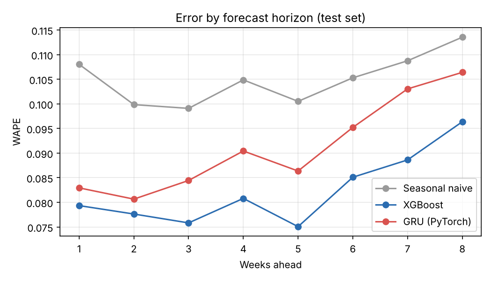
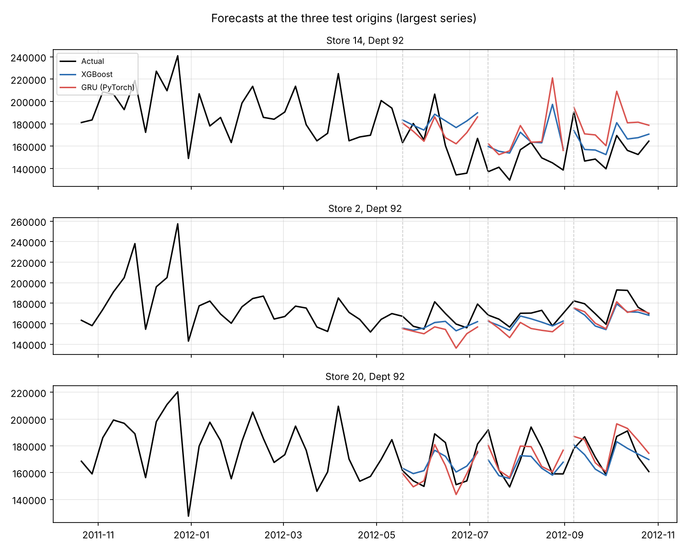

# Retail demand forecasting with PyTorch

Weekly sales forecasting for ~2,600 store-department series from Walmart, comparing
a global GRU model in PyTorch against two baselines a retailer would actually use:
seasonal naive and XGBoost.

The question: **does a deep learning model earn its place over a well-built
gradient-boosting baseline for 8-week-ahead demand forecasts?**

## Results

Test set: 2,632 series x 3 forecast origins (May, July, September 2012) x 8 weeks.

| Model | WAPE | MAE ($) | WMAE ($, Kaggle metric) | Bias |
| --- | ---: | ---: | ---: | ---: |
| Seasonal naive | 10.5% | 1,858 | 1,875 | -1.9% |
| **XGBoost** | **8.2%** | **1,457** | **1,457** | -0.8% |
| GRU (PyTorch) | 9.1% | 1,614 | 1,599 | **-0.1%** |

**XGBoost wins.** Both learned models clearly beat seasonal naive (XGBoost cuts its
WAPE by 22%, the GRU by 13%), but the GRU does not beat a well-featured gradient-boosting
model: it has a 0.9-point higher WAPE overall and beats XGBoost on only 40% of the test
windows. XGBoost is better at every horizon and every test origin, and trains in about a
seventh of the time.

What the GRU does better: it is almost unbiased (-0.1% vs -0.8% for XGBoost), so summed
over many departments its forecasts would not systematically under-order stock.

Why it probably lost, from what the experiment shows:

- **Not much data per series.** 143 weeks per series is under three seasons. Tree models
  with explicit lag features are known to be strong in this regime; deep models
  usually need longer histories or many more series.
- **Noisy early stopping.** Validation loss moved up and down between epochs (best at
  epoch 6, stopped at 11). A single validation origin is a noisy signal for choosing
  the checkpoint.

For a forecasting team, the practical conclusion is to ship XGBoost and keep the GRU as a
candidate for an ensemble or for data with longer histories.





## Data

[Walmart Recruiting – Store Sales Forecasting](https://www.kaggle.com/competitions/walmart-recruiting-store-sales-forecasting)
(Kaggle): weekly sales for 45 stores x up to 81 departments, February 2010 to October 2012,
with a flag for the four major US holidays (Super Bowl, Labor Day, Thanksgiving, Christmas).

Preparation (`src/demand_forecast/data.py`):

- Keep only store-department series observed in all 143 weeks (2,660 of 3,331) and with
  mean weekly sales of at least 100. Gaps are not imputed, so the model never learns
  from sales that were invented. Result: 2,632 series.
- Clip negative weekly sales (returns larger than sales, 0.3% of rows) to zero.

## Method

**Set-up.** Each forecast uses the last 52 weeks of history and predicts the next 8.
Everything the models see about the future is known at forecast time: holiday flags,
week of year, and sales in the same weeks last year.

**Scaling.** Each window is divided by the mean of its history, so one global model can
learn from departments selling a few hundred and a few hundred thousand dollars a week.

**Models.**

| Model | What it does |
| --- | --- |
| Seasonal naive | Sales in the same week last year |
| XGBoost | One global model; 52 scaled lags, recent means, store and department, horizon step and the known future covariates as features; L1 objective |
| GRU (PyTorch) | GRU encoder over the history, store and department embeddings, an MLP head over the encoder state and the future covariates. It predicts a correction on top of last year's sales and is trained with L1 loss, matching the main metric |

**Validation, without leakage.** A rolling-origin backtest:

- Training windows: every origin whose 8-week target ends before the validation week.
- Validation: one origin (March 2012), used for early stopping and nothing else.
- Test: three later origins (May, July and September 2012), 8 weeks each, with the models
  frozen. 7,896 test windows in total.

**Metrics.** WAPE (sum of absolute errors over sum of sales) is the main one because it
weights errors by volume, which is what matters for stock and revenue. Also MAE, the
Kaggle WMAE (holiday weeks weighted x5) and bias.

## Run it

Requires [uv](https://docs.astral.sh/uv/). PyTorch installs as a CPU-only build.

```bash
uv sync

# Data: accept the competition rules on Kaggle, then
uvx kaggle competitions download -c walmart-recruiting-store-sales-forecasting -p data/raw
# unzip so that data/raw/train.csv exists

uv run python scripts/run_backtest.py --data data/raw/train.csv
uv run pytest
```

`--quick` trains for two epochs, for a smoke test. The full run takes about 10-15 minutes on a laptop CPU, most of it training the GRU.

Outputs in `results/`: `metrics.csv` (per model and test origin), `wape_by_horizon.csv`,
`summary.json`, `gru_training_history.csv` and the two plots.

## Tests

`tests/` runs on a small synthetic dataset, so CI needs no data:

- the panel keeps only complete series and clips negative sales,
- windows unscale back to the raw sales,
- **no leakage**: the history stops right before the origin and last year's values come
  from the past,
- training origins end before the validation week,
- the GRU can overfit one batch (gradients flow) and training is reproducible with a fixed seed,
- the metrics give known values on hand-computed examples.

## Project layout

```
src/demand_forecast/
  config.py      experiment settings (lookback, horizon, origins, hyperparameters)
  data.py        raw CSV -> dense (series x week) panel
  windows.py     panel -> scaled (history, future covariates, target) windows
  baselines.py   seasonal naive and XGBoost
  model.py       GRU forecaster and training loop with early stopping
  metrics.py     WAPE, MAE, WMAE, bias
scripts/run_backtest.py   end-to-end experiment
tests/                    unit tests on synthetic data
```

## Limitations and next steps

- Validate on several origins instead of one, to make early stopping less noisy.
- Average XGBoost and GRU forecasts: the GRU is better on 40% of windows, so an
  ensemble may beat both.
- One training cut: the models are not retrained at each test origin. Retraining would
  give a more realistic production estimate.
- Only point forecasts. Quantile forecasts (pinball loss) would be the natural next step,
  since stock decisions depend on uncertainty, not just the mean.
- The markdown, CPI and other store-level covariates in Kaggle's `features.csv` are not used.
- No hyperparameter search: both models use sensible defaults, tuned only by early stopping.
